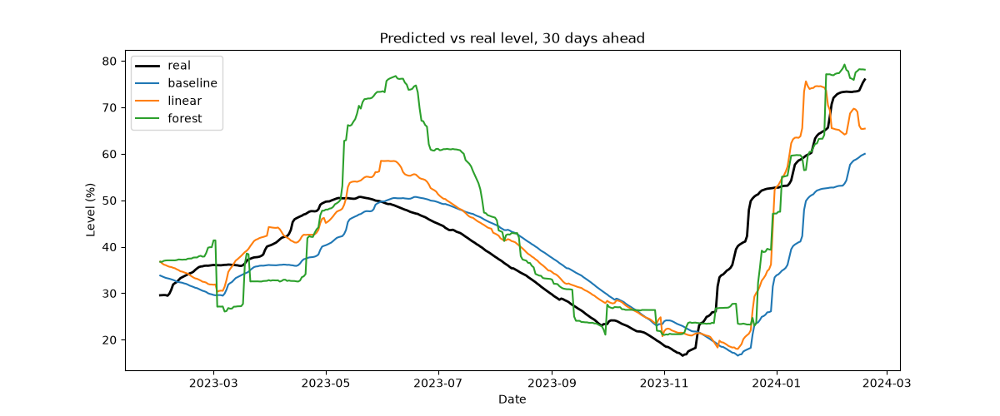
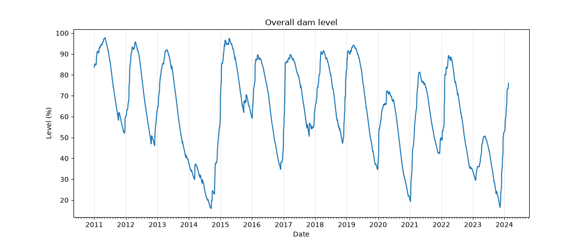
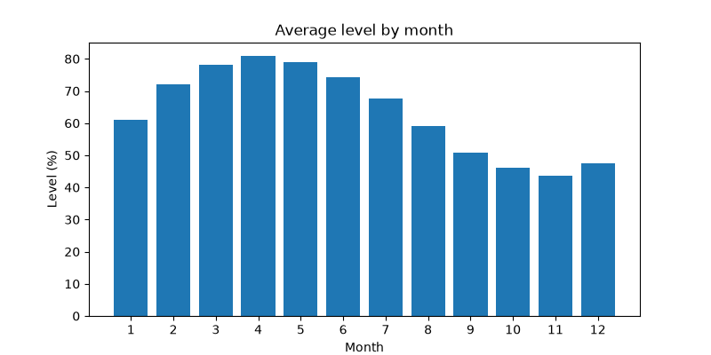
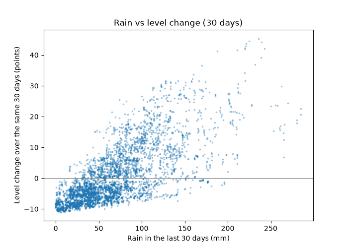

# dam-forecast

Predicting Istanbul's overall dam occupancy **30 days ahead** from today's level, recent rain, water use and the time of year, using classical machine learning (pandas, scikit-learn). No language model.

## Result in short

| Method | Average miss (MAE, points) | Too full (dangerous) | Too empty |
|---|---|---|---|
| Baseline: "same as today" | 8.05 | 182 days, avg +5.3 | 202 days, avg −10.5 |
| **Linear regression** | **6.03** | 266 days, avg +5.1 | 118 days, avg −8.2 |
| Random forest | 8.38 | 247 days, avg +9.1 | 137 days, avg −7.2 |

Test period: 2023-01-01 to 2024-01-19 (384 prediction days, each predicting the level 30 days later).

- **Linear regression beats the baseline by about 25%** on average.
- **But it makes the dangerous mistake more often.** Guessing "too full" leads to complacency about water supply. The baseline did it on 182 days, linear regression on 266.
- **The random forest is worse than the baseline.** Its misses in late spring 2023 are the largest of all methods, and on the dangerous side.
- **Every method fails on the December 2023 refill**, which was driven by heavy rain that no input could foresee.



## Data

Source: İBB Open Data Portal (data.ibb.gov.tr), published by İSKİ.

| File | Contents | Range |
|---|---|---|
| `istanbul-dams-daily-occupancy-rates.xlsx` | daily occupancy of 10 dams | 2000-10-23 to 2024-02-19 (8520 days) |
| `istanbul-barajlarnda-ya-ve-gunluk-tuketim-verileri.xlsx` | daily rain at the 10 dams + city water use (m³/day) | 2011-01-01 to 2024-02-18 (4797 days) |

Only the overlap is used: **2011-01-01 to 2024-02-18, 4797 days**.

## Data cleaning (`src/clean.py`)

- Removed the empty column `Unnamed: 11` from the rain file. It was empty in all 4797 rows.
- Renamed columns: `occ_<dam>` for occupancy, `rain_<dam>` for rain, `consumption` for water use.
- **130 dates stored as text** (`1.4.2023` style, 2023-04-01 to 2023-08-08). They were converted with the explicit format `%d.%m.%Y`, never guessed.
- **The same 130 rows stored occupancy in percent, all other rows as fractions** (0.65 vs 65). Every value was converted to percent. This passed a 0–100 range check because both units fit inside it. It was found by comparing `describe()` quartiles with the max.
- **Zeros:**
  - Alibey's 210 zero days are all before 2011, so the join removes them.
  - Pabuçdere's single zero (2013-12-31) is real: a slow decline to 0 and a slow rise. It was kept.
- No empty cells. Every date appears exactly once with no gaps: `diff().value_counts()` shows only `1 days`.
- **Overall level `occ_total`** = total water ÷ total capacity × 100, using the current official dam capacities. A simple average would let a dam 40 times smaller count equally.
  - **Check against published values:** 74.51 vs İSKİ's 73.25 on 2024-02-16, and 33.42 vs 33.02 on 2023-12-01.
  - The remaining gap of about 1 point is likely due to capacity changes or different measurement times. This is not confirmed.
- **Join:** inner join on date gives `(4797, 23)`, saved to `data/processed/dams_clean.csv`.

## Data exploration (`scratch/eda.py`)



- **Strong yearly cycle.** The level rises from December to April and falls from May to November. The fullest month is **April (about 81%)** and the emptiest is **November (about 44%)**.
- **Falls are slow, rises are fast.** The yearly drop takes about 8 months, but a refill can take 1–2 months (early 2015: from about 16% to about 95%).
- **Drought years:**
  - 2014: the lowest point, about 16%.
  - 2020–21: down to about 19%.
  - 2023: the peak was only about 51%, and the low about 17%.
  - In each case, a weak winter peak was followed by a very low autumn.
- **Rain drives the level.** Rain over 30 days and the level change over the same 30 days have a **correlation of 0.74**.
  - With almost no rain, the level drops about **10 points per month**, from water use.
  - Break-even is about **70–80 mm of rain per 30 days**.




## Method

- **Target:** the overall level 30 days later, `occ_total.shift(-30)`.
- **Inputs:** only today and the past.
  - today's level
  - the level change over the last 30 days
  - average rain over the last 30 days
  - average water use over the last 30 days
  - the month, as 12 yes/no columns
- **Split by date, never shuffled:**
  - Train: 2011 to 2022-12-01. Training stops 30 days before the test period, so no training answer falls inside it.
  - Test: 2023-01-01 onward.
- **Models:** the baseline (`src/baseline.py`), `LinearRegression` (`src/linear.py`), and `RandomForestRegressor` with 300 trees and `min_samples_leaf=5` (`src/forest.py`).
- **Scoring:** the average miss (MAE). It's also split into "too full" and "too empty", because the two kinds of error don't cost the same.

## Where the models fail (`src/evaluate.py`)

Average miss per month in points (+ = too full, − = too empty):

| Month | Baseline | Linear | Forest |
|---|---|---|---|
| 2023-01 | 4.2 | 7.2 | 7.2 |
| 2023-02 | −1.7 | 0.6 | 4.2 |
| 2023-03 | −3.7 | 0.4 | −6.0 |
| 2023-04 | −8.1 | −2.2 | −8.5 |
| 2023-05 | −5.0 | 1.7 | 12.8 |
| 2023-06 | 2.7 | 8.3 | **23.9** |
| 2023-07 | 5.6 | 5.4 | 14.5 |
| 2023-08 | 7.6 | 5.1 | 4.7 |
| 2023-09 | 7.5 | 4.7 | 0.2 |
| 2023-10 | 4.3 | 4.0 | 3.9 |
| 2023-11 | 1.4 | 0.5 | 2.2 |
| 2023-12 | **−23.3** | **−18.5** | **−14.4** |
| 2024-01 | −14.5 | 7.0 | 1.2 |
| 2024-02 | −17.3 | −7.2 | 4.1 |

- **May–July 2023: the forest is too full by 13–24 points.** It predicted about 75% while the real level was about 50%. 2023 had a dry spring, and the forest answered with levels typical of past springs (75–95%), which it had seen many times. A spring at 50% was almost never in the training data. This is the most dangerous error of the test.
- **December 2023: everyone is too empty by 14–23 points.** The level jumped from about 17% to about 50% in a few weeks after heavy rain. None of the inputs can see future rain.
- **The baseline is too full July–October**, because it ignores the regular summer drop, and too empty whenever the level rises.
- **Linear regression is the most stable.** It's close to zero in February–April and November, with moderate misses elsewhere.

## Why the tree model did worse than linear regression

- **The forest predicts by copying levels from similar past days.** With only 12 years of history, it learned what a *typical* level is for each season. When 2023 behaved unusually (a dry spring), it gave a "normal" answer that was far from reality.
- **Linear regression works like "today's level plus an adjustment".** It follows the current level, so it can't drift as far.
- With little data and an unusual test year, the simpler model generalizes better.

## Limitations

- **The test period is unusual:** a drought year followed by a sharp refill. Scores on a normal year would probably look better.
- **Future rain is unknown,** so sudden refills can't be predicted from these inputs. A weather forecast as an input could help.
- **Capacities are today's official values.** The computed overall level is about 1 point off published figures.
- **No tuning was done.** Every model ran once with first-choice settings.

## Possible improvements (not done)

- **Predict the 30-day change instead of the level.** This should help the forest most, because it would learn "how much the level moves" rather than "what level is normal".
- **Add a "below normal for this month" input:** today's level minus the usual level for this month.
- **Add longer rain windows** (60 or 90 days).
- **Add a safety margin, or a model that aims slightly low** (quantile regression), to cut "too full" errors.
- **Tune on a validation period** (train 2011–2020, validate 2021–2022), and test on 2023 only once at the end.

## How to run

```
python -m venv .venv
.venv\Scripts\Activate.ps1
python -m pip install pandas openpyxl matplotlib scikit-learn

python src/clean.py        # raw Excel files -> data/processed/dams_clean.csv
python scratch/eda.py      # exploration charts -> figures/
python src/baseline.py     # baseline score
python src/linear.py       # linear regression score
python src/forest.py       # random forest score
python src/evaluate.py     # predicted-vs-real chart + monthly misses
```

## Project structure

```
data/raw/          original files, never edited
data/processed/    dams_clean.csv (built by src/clean.py)
src/               cleaning, baseline, models, evaluation
scratch/           exploration scripts (explore.py, eda.py)
figures/           charts used in this README
```
